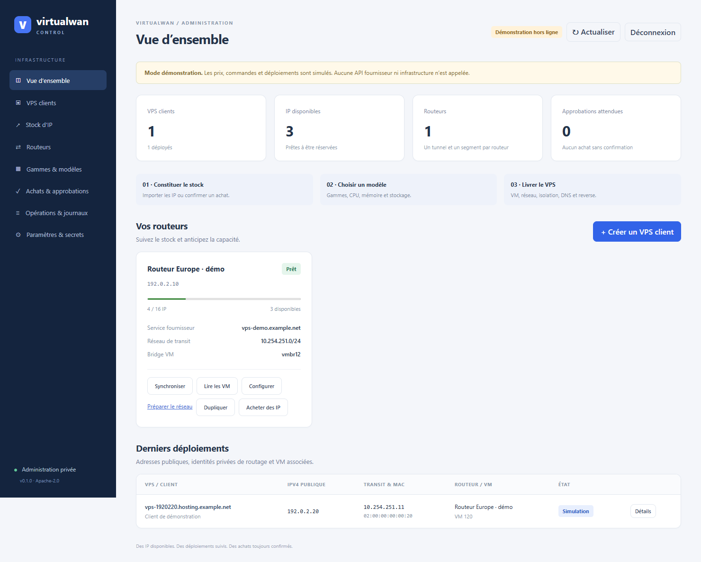

# Virtualwan Control

**Apache-2.0 · Self-hosted · OVHcloud + pfSense + Proxmox + Cloudflare**

Une console privée pour provisionner des VM clientes avec une IPv4 publique
dédiée, routée depuis un VPS vers votre infrastructure par WireGuard, sans
NAT de l'adresse cliente. Le réseau de transit privé reste côté pfSense ;
l'invité Debian reçoit uniquement son IPv4 publique /32 via Cloud-init.



Le code applicatif de ce dossier est générique. La distribution publique contient
le code applicatif et le workflow `.github/workflows/docker-publish.yaml`. Les
documents d’exploitation du dossier parent et ses données personnelles sont exclus.

## Ce que fait l'application

- Inventaire des routeurs OVH, IP disponibles/réservées/affectées et VM ;
  affichage public /32, MAC, prochain saut ARP privé, VMID, nœud, hostname.
- Synchronisation des IP possédées/routées depuis OVH, lecture des VM
  enregistrées sur Proxmox, import d'une installation existante.
- Modèles nommés et gammes : CPU, RAM, disque, template Proxmox ; ces paramètres
  sont figés au lancement d'un déploiement.
- Création depuis une IP en stock : réservation atomique, VM arrêtée, DNS A
  Cloudflare DNS-only, PTR OVH, routes VPS/pfSense, Kea/ARP permanent, isolation,
  démarrage et contrôles. Les méthodes SSH clé/mot de passe/les deux existent.
- Achat d'IP en avance, ou achat d'une IP suivi d'une VM avec clé SSH dans le
  même parcours. Le stock doit rester routé vers un service OVH.
- Duplication d'un profil de routeur au plafond des 16 IP : nouveau segment,
  nouveau service, alias distinct, devis de VPS soumis à approbation. Les
  nouvelles IP se commandent une fois ce nouveau service livré.
- Confirmation humaine de tout achat : prix/contrats du devis OVH, expiration,
  phrase de confirmation, paiement automatique facultatif. Notification SMTP
  possible ; le lien ouvre une interface authentifiée et n'approuve rien.
- Journaux par opération, coffre de secrets chiffré, états d'échec/reprise.

Les adaptateurs de provisionnement supportent aujourd'hui OVH, Cloudflare,
pfSense WebGUI/Kea et Proxmox. Les identifiants, interfaces, subnets, stockages,
templates, DNS et paramètres SSH sont configurables. « Générique » ne signifie
pas compatibilité déjà implémentée avec tous les fournisseurs/hyperviseurs.
Le mode fournisseur manuel gère l'inventaire ; DNS/PTR automatiques du
provisionnement restent ceux d'OVH/Cloudflare dans cette version.

## Démarrage Docker sur votre VM de management

Prérequis : Docker Engine et le plugin Compose. Aucun déploiement automatique
sur votre hôte n'est déclenché par ce dépôt.

```sh
cp .env.example .env
# Personnaliser VWAN_ADMIN_PASSWORD avec un mot de passe long et unique.
docker compose up -d --build
docker compose logs -f control
```

Par défaut : écoute **127.0.0.1:8080** sur la VM, achat et provisionnement
réels désactivés. Pour accéder depuis votre poste sans exposer la console :

```sh
ssh -L 8080:127.0.0.1:8080 utilisateur@VM_MANAGEMENT
```

Ouvrir `http://localhost:8080`, utilisateur `admin`, mot de passe de `.env`.
L'app démarre avec un inventaire vide en mode réel. Le volume `control-data`
contient la base, la clé du coffre, les clés hôtes SSH et les journaux.
Sauvegarder le volume chiffré ; la base seule ne suffit pas pour restaurer les
secrets, et la base + sa clé permettent de les déchiffrer.

### Une image, un serveur web, une base locale

Compose lance un seul conteneur : l'application Flask, Uvicorn et SQLite.
Aucun Caddy, aucun PostgreSQL, aucun socket Docker. SQLite est dans le volume
persistant `/data`. Une seule instance de la console doit accéder à ce volume.

Pour utiliser l'image publiée par GitHub Actions :

```sh
docker compose pull
docker compose up -d --no-build
```

Configurer `VWAN_IMAGE` pour votre dépôt GHCR ; le défaut de cet exemple est
`ghcr.io/jul-fls/virtualwan-control:latest`. Avant la première
publication, `docker compose up -d --build` permet de construire localement.
Le package GHCR doit être public pour un téléchargement anonyme.

L’application écoute uniquement en **HTTP sur le port 8080**. Terminer HTTPS
avec Cloudflare Tunnel/Access Zero Trust ou Nginx Proxy Manager, selon votre
installation. Aucun certificat, clé TLS ni renouvellement n’est géré par l’app.

Configurer `VWAN_PUBLIC_URL=https://control.example.net` avec l’URL publique
réelle et transmettre le `Host` d’origine au backend HTTP. L’app conserve ainsi
les cookies Secure et les contrôles Host/Origin pour les accès via le proxy.
La connexion du proxy au conteneur utilise `http://control:8080` lorsqu’ils
partagent un réseau Docker, ou le port publié de la VM selon votre installation.
`VWAN_BIND_ADDRESS` choisit l’adresse du port publié ; le défaut reste localhost.

L’authentification interne reste active même derrière Cloudflare Access.
`VWAN_TRUSTED_PROXY` est facultatif : renseigner l’IP exacte du proxy direct
pour utiliser un seul saut de `X-Forwarded-For` dans la limitation des tentatives.
Sans cette variable, les en-têtes de forwarding ne sont pas considérés fiables.

### Authentification et configuration par environnement

Un compte administrateur est défini par `VWAN_ADMIN_USER` et
`VWAN_ADMIN_PASSWORD` (12 caractères minimum, aucun mot de passe par défaut).
Le mot de passe est vérifié via un hash scrypt ; les sessions durent huit heures
et utilisent un cookie HttpOnly/SameSite Strict, Secure si l'URL est HTTPS.
Les mutations exigent une session et un token CSRF. Huit tentatives en cinq
minutes déclenchent un blocage temporaire ; cette limitation est locale au
processus. Changer le compte/mot de passe puis redémarrer révoque les sessions.
L’administration garde son compte de démarrage. Les comptes clients et leurs sessions sont distincts ; ils disposent de MFA TOTP et de passkeys dans `/client`.

Toute la configuration de démarrage et tous les secrets peuvent être injectés
par environnement ; `.env` est un exemple de chargement par Compose, pas un
fichier de configuration obligatoire de l'application.

- `VWAN_ADMIN_USER`, `VWAN_ADMIN_PASSWORD`, `VWAN_PUBLIC_URL`, `VWAN_DATA_DIR`.
- `VWAN_DEMO`, `VWAN_ENABLE_PROVISIONING`, `VWAN_ENABLE_PURCHASES`.
- `VWAN_ROUTER_BOOTSTRAP`, `VWAN_PROFILE_ID` et les variables simples
  `VWAN_ROUTER_*`, `VWAN_PVE_*`, `VWAN_PFSENSE_*`, `VWAN_GUEST_*`, etc.
  initialisent un routeur une fois. Tous les champs sont dans `.env.example`.
- `VWAN_MODEL_BOOTSTRAP`, `VWAN_MODEL_ID`, `VWAN_MODEL_NAME`,
  `VWAN_MODEL_RANGE`, `VWAN_MODEL_CORES`, `VWAN_MODEL_MEMORY_MB`,
  `VWAN_MODEL_DISK_GB`, `VWAN_MODEL_TEMPLATE` initialisent un modèle une fois.
- Les profils et modèles supplémentaires se créent et s’éditent dans l’UI.
- Les variables référencées par `*_env` contiennent les identifiants OVH,
  Cloudflare, pfSense, PVE et routeurs. **L'environnement a priorité sur le coffre**.
- `VWAN_TRUSTED_PROXY` et `VWAN_SMTP_*`/`VWAN_APPROVAL_EMAIL` sont facultatifs.
  `VWAN_IMAGE` et `VWAN_BIND_ADDRESS` sont utilisés par Compose.

Exemple de modèle dans `.env` :

```dotenv
VWAN_MODEL_BOOTSTRAP=true
VWAN_MODEL_ID=small
VWAN_MODEL_NAME=Small
VWAN_MODEL_RANGE=Essentiel
VWAN_MODEL_CORES=2
VWAN_MODEL_MEMORY_MB=2048
VWAN_MODEL_DISK_GB=32
VWAN_MODEL_TEMPLATE=9001
```

Les bootstrap scalaires sont importés une fois en base : les modifications
ultérieures de l’UI sont conservées. Les variables de connexion et IPv6 ciblées
restent des overrides explicites ; les retirer si l’UI doit gérer aussi ces champs.
Aucun JSON n’est nécessaire dans les variables d’environnement.

Les anciennes variables `VWAN_PROFILES_JSON` et `VWAN_MODELS_JSON` restent acceptées
comme **import de compatibilité**, sans écraser un objet existant en base. Pour
migrer une installation existante, voir [le guide du portail](docs/PORTAIL-CLIENT.md).

### Publication GitHub Actions

Le workflow `.github/workflows/docker-publish.yaml` reprend le modèle demandé :
checkout, login GHCR avec `GITHUB_TOKEN`, puis construction et publication de
**`ghcr.io/jul-fls/virtualwan-control:latest`**. Le contexte est la racine du dépôt.

Il s’exécute sur `main`/`master` et peut être lancé manuellement. Les pull requests
construisent l’image sans connexion au registre ni publication. Une seule image,
un seul tag `latest`, sans matrice Python ni étapes de tests dans cette pipeline.
Les actions suivent leurs branches courantes (`main`/`master`), sans version ou
SHA épinglé. Le Compose utilise la même image ; `VWAN_IMAGE` reste configurable.

Aucun secret OVH/pfSense/PVE/Cloudflare n’est nécessaire dans GitHub Actions.
Le workflow publie l’image ; il ne déploie pas la console sur la VM de management.

### Démonstration sans infrastructure ni achats

Dans un répertoire/projet Compose et un volume **distincts**, mettre
`VWAN_DEMO=true`. Des routeurs, modèles et IP de documentation sont créés.
Le bandeau et les résultats signalent explicitement la simulation. Les prix
de démonstration ne sont pas les prix OVH. Aucune API externe n'est appelée.
Le même volume ne peut pas être basculé entre modes démo et réel.

## Brancher l'infrastructure existante

1. Routeurs → Ajouter : éditer l'exemple JSON, renseigner les interfaces
   internes pfSense réelles, bridge, nœud, stockages et template PVE, domaine,
   endpoint API OVH/filiale et nom du service. Les valeurs de l'exemple sont
   documentaires : elles ne découvrent ni n'installent votre réseau.
2. Paramètres → Secrets : ajouter les valeurs sous les noms `*_env` utilisés
   par le profil. Secrets distincts possibles pour chaque routeur/compte.
   La clé privée SSH, si utilisée, se monte sous `/data` ; son chemin dans le
   profil est relatif à data. Les mots de passe sont aussi pris en charge.
3. Configurer une CA ou une empreinte SHA-256 du certificat pfSense. Vérifier
   et enregistrer les empreintes SSH via le profil, en les comparant hors bande.
4. Le réseau doit déjà avoir le tunnel, le scope Kea/ARP, les gateways et règles
   de routage ainsi que l'isolation des clients. Le preflight contrôle ces
   prérequis et refuse d'improviser une configuration physique.
5. Synchroniser les IP OVH et Lire les VM sur le routeur. Le primaire ne rejoint
   jamais le stock. Les IP manquantes sont mises en quarantaine, pas supprimées.
6. Configurer les modèles et activer `VWAN_ENABLE_PROVISIONING=true` après
   validation. Redémarrer le service pour appliquer les variables d'environnement.

L'import CLI `tools/import-legacy.py` accepte une configuration du CLI Virtualwan
et un registre d'isolation, ainsi qu'un JSON de secrets et un known_hosts
optionnels. **Arrêter l'app avant l'import**. Il ne contacte pas les serveurs,
n'achète rien et marque les VM importées comme à vérifier. Voir
[la migration](docs/MIGRATION.md).

## Acheter et affecter

Configurer les droits API supplémentaires dans [OVH-API.md](docs/OVH-API.md),
puis mettre `VWAN_ENABLE_PURCHASES=true`. Sans cette variable, un devis peut
être préparé mais aucun checkout réel ne peut être envoyé.

1. Stock d'IP → Acheter, choisir le routeur, charger le catalogue OVH, choisir
   explicitement le plan Additional IP, la quantité, la durée et sa tarification.
   Les configurations requises sont celles de l'offre OVH ; aucun SKU/prix/datacenter
   n'est codé en dur. Un devis incomplet affiche les champs requis et n'achète rien.
2. Pour créer également la VM, cocher la suite du parcours, choisir le modèle
   et fournir la clé SSH publique. Le modèle est conservé dans le devis.
3. Achats → Examiner : vérifier toutes les lignes, les taxes et les contrats.
   Saisir `COMMANDER <référence>` et accepter les contrats. Le backend recontrôle
   les prix et la version du profil ; un changement impose un nouveau devis.
4. Le paiement automatique avec le moyen préféré OVH est un choix explicite.
   Sinon, terminer le paiement via le lien de commande OVH.
5. Le worker suit la livraison toutes les cinq minutes (ou à la demande).
   Il n'affecte que les IP liées sans ambiguïté aux lignes de cette commande,
   réellement livrées et retrouvées dans l'inventaire du bon routeur. Si OVH ne
   fournit pas cette correspondance, réconcilier manuellement le stock ; aucune
   adresse n'est devinée à partir d'un simple différentiel global.

Une interruption après checkout donne **Réponse incertaine** : comparer les
commandes OVH et ne pas recommander aveuglément. Les achats ne sont jamais
repris automatiquement. Un échec de déploiement garde l'IP en quarantaine,
avec reprise explicite du même run et des ressources déjà enregistrées.

## Au plafond : un routeur supplémentaire

Les IP en stock et celles des commandes en attente comptent dans la capacité.
OVH VPS limite actuellement celle-ci à 16 Additional IP ; les prévisions
locales ne remplacent pas les contrôles du fournisseur.

Routeurs → Dupliquer : nouveau réseau de transit sans chevauchement ; le profil
reste non prêt, ses IP/service et interfaces sont remis à renseigner, et ses
alias/segment/secret SSH sont distincts. Préparer le devis VPS depuis ce profil
vide, puis confirmer humainement. Une livraison identifiable renseigne son
service et son IP primaire ; l'état reste **Configuration requise**.

Télécharger le dossier « Préparer le réseau » : configuration du routeur et
fragment de registre multi-segment, outils Linux et procédure d'onboarding.
L'opérateur vérifie VLAN, uplink, MAC pfSense, /30 du tunnel et interfaces.
L'achat d'un serveur ne suffit pas à autoriser un remplacement aveugle du réseau.
Après livraison du VPS, renseigner ses identifiants SSH dans l'environnement,
vérifier sa clé hôte avec la console OVH, et renseigner un /30 distinct ainsi que
la clé publique du nouveau tunnel pfSense. Dans Routeurs, utiliser **Installer
le routeur SSH**, puis saisir la phrase `CONFIGURER <référence>`.

Cette action vérifie l'IP primaire auprès du service OVH, contrôle un Debian 13
neuf et sa route de management, installe WireGuard/nftables, configure le service
persistant et les routes /32. Elle arme un rollback de cinq minutes, ouvre une
nouvelle connexion SSH et vérifie la sortie primaire avant de désarmer le timer.
La clé WireGuard publique du routeur est retournée dans le résultat du job ;
la reporter sur le peer pfSense. Une installation existante est refusée, sans
mise à jour aveugle. Un échec impose une inspection du journal/rollback avant reprise.

Les changements initiaux pfSense/PVE (nouveau tunnel/VLAN/bridge/isolation)
ne sont pas appliqués automatiquement dans cette version. Les artefacts du
bouton Préparer le réseau les documentent ; le profil reste non prêt tant que
l'opérateur n'a pas préparé et testé ces éléments. Ensuite, les IP/VM du segment
préparé se provisionnent par l'UI. Ce bootstrap SSH n'a pas encore fait l'objet
d'une installation réelle sur un second VPS ; il doit être testé sur un serveur jetable.
La limite est paramétrable à la baisse ; l'app ne commande jamais un nouveau
routeur à votre insu lorsque le seuil est atteint.

## Architecture et périmètre

Flask/Uvicorn, UI HTML/CSS/JS sans dépendances frontend externes, SQLite,
un worker de jobs. Utiliser **un seul processus / une seule instance** ; la
reprise et les verrous ne constituent pas une architecture multi-controller.
Pas de facturation client, suppression automatique, HA de la console ou portail
de clients dans cette version. Garder PVE/QEMU à jour ; l'isolation réseau ne
garantit pas contre une sortie de VM exploitant une faille d'hyperviseur.

Le service d'isolation multi-segment conserve la compatibilité avec le registre
historique plat. Pour plusieurs routeurs dans un même cluster, créer un bridge
et une table par segment ; valider les chemins tap/fwpr/fwbr, reboot et migration
sur votre matériel avant admission. Aucune mise à jour du service de production
existant n'est faite par le lancement de la console.

## Développement / tests

```sh
python -m venv .venv
. .venv/bin/activate
pip install -r requirements.txt
python -m unittest discover -s tests -v
```

Tests locaux : allocation concurrente, capacité/stock, profil dupliqué,
approbation/montant/expiration, timeout de paiement, secret chiffré, sessions,
CSRF et protection du mode démo. Ils ne constituent pas des achats ou des
déploiements réels. Le déploiement CLI historique a été testé séparément ;
les nouveaux chemins d'achat/onboarding nécessitent une recette fournisseur.
Voir [VALIDATION.md](docs/VALIDATION.md) et [SECURITY.md](SECURITY.md).

Licence : [Apache-2.0](LICENSE). Les dependencies conservent leurs licences.
Publier uniquement le contenu distribuable de ce dossier ; jamais son data,
le fichier `.env` ou le dossier parent d'exploitation. Voir le script
`tools/export-source.py` pour créer et contrôler une archive publique.

Sources : [limite Additional IP OVH](https://www.ovhcloud.com/fr/vps/vps-ip/),
[schéma Order API officiel](https://eu.api.ovh.com/1.0/order.json),
[API /me/order](https://eu.api.ovh.com/1.0/me.json),
[nftables bridge](https://wiki.nftables.org/wiki-nftables/index.php/Bridge_filtering),
[Cloud-init Proxmox](https://pve.proxmox.com/pve-docs/chapter-qm.html#qm_cloud_init),
[Uvicorn](https://www.uvicorn.org/).

## Connexions simples et première clé SSH

Les variables VWAN_PFSENSE_URL, VWAN_PFSENSE_CONNECT_IP, VWAN_PVE_HOST,
VWAN_PVE_PORT, VWAN_PVE_NODE et VWAN_PVE_USERNAME remplacent les champs
correspondants d’un profil au démarrage. Avec un seul profil, celui-ci est
sélectionné automatiquement ; avec plusieurs, fournir son id dans VWAN_PROFILE_ID.
Elles s’appliquent au JSON initial ou au profil déjà enregistré si le JSON est vide.
Elles ne créent pas à elles seules un profil complet.

Sur un volume Docker neuf, le fichier /data/ssh-known-hosts n’existe pas encore.
Dans Routeurs → Configurer → Vérifier clé SSH PVE (puis routeur), comparer
l’empreinte à celle de la console de l’hôte puis saisir ACCEPTER pour l’enregistrer.
La présence d’un mot de passe n’autorise pas automatiquement une clé hôte.
Ensuite, relancer Lire les VM ; les erreurs signalent cette étape manquante.
Conserver /data sur le volume persistant. Après changement d’environnement,
recréer le conteneur pour charger les valeurs (un simple restart ne recharge
pas le fichier .env).

## Devis guidés et restitution des IP

Achats & approbations utilise le catalogue OVH disponible pour votre compte :
filtre SSD/NVMe, RAM de la gamme, CPU/disque affichés, options par famille,
durée, localisation et OS. Les IP disposent de choix de pays lorsque l’offre
les propose. Les paramètres sont des champs/selecteurs, sans JSON à recopier.
CPU/RAM/disque principal sont liés à la gamme ; aucun dimensionnement libre
non proposé par OVH n’est inventé. Les prix affichés dans les choix sont HT ;
le devis final TTC et les contrats restent soumis à confirmation humaine.

Les sélections créent des paniers non payés de quinze minutes, liés au profil
et utilisables une seule fois pour préparer le devis. Les options obligatoires
et exclusives, les valeurs proposées et les changements de profil sont contrôlés.
Les nouveaux paniers requièrent les droits POST/GET /order/cart/*, notamment
les routes vps/options ; aucun checkout n’est envoyé par la sélection.

La même page liste les VM clientes et sépare Libérer l’IP, Supprimer la VM
et Supprimer & libérer l’IP. Pour cette dernière action :
Cette action détruit les disques de la VM après confirmation SUPPRIMER.
Elle ne résilie pas le VPS routeur OVH et ne rend pas l’IP au fournisseur :
l’IP reste achetée pour un futur client. Le nettoyage vérifie VMID/MAC/bridge,
registre d’isolation, routes, gateway, réservation Kea/ARP et règles gérées.
Les états pfSense sont purgés uniquement pour cette IP ; le LAN et les autres
clients ne sont pas réinitialisés. L’alias des IP possédées est conservé.

Une IP neuve ou restituée reçoit un A DNS-only et un PTR au même nom classique
que pour un nouveau déploiement : vps-127012.hosting.example.net pour 127.0.1.2,
avec le hostname_pattern du profil (défaut vps-{ipv4_compact}.{domain}).
Le reset envoie explicitement DELETE/POST à OVH, même si le PTR est déjà classique,
puis vérifie sa valeur ; un PTR personnalisé est ainsi écrasé à la restitution.
L’attribution à un client conserve ce format de déploiement habituel.
Le routeur distingue additional_ips (clients) et inactive_ips (stock), avec
blackhole /32 persistant et refus de forwarding pour le stock. La première
préparation de stock met à jour uniquement son outil Virtualwan, avec sauvegarde
du script/config existants et vérification de la route primaire. Le nouveau
format accepte toujours les anciens fichiers sans inactive_ips.

L’IP n’est disponible qu’après vérification DNS/PTR et nettoyage complet.
Un échec laisse l’IP en quarantaine et le journal pour inspection/reprise du
même job. Les DNS non gérés ou alias résiduels ne sont pas supprimés aveuglément
et bloquent la restitution. Avant de classer une IP synchronisée libre, le
registre PVE et les routes pfSense sont lus : un client existant non importé
ne doit pas être coupé. Préparer/réinitialiser DNS permet de reprendre un stock
non affecté ; une IP affectée à une VM est refusée par cette action.

Les nouveaux achats/nettoyages doivent être testés sur une VM jetable et un
petit achat contrôlé avant production. Les validations locales utilisent des
simulations et des fixtures ; aucun achat ni suppression réel n’a été effectué.


### Libérer une IP ou supprimer une VM

Dans **Achats & approbations**, les actions sont indépendantes :

- **Libérer l’IP** (`LIBERER`) : arrêt de la VM, retrait de sa carte `net0`
  publique et de son hook Virtualwan, nettoyage des routes et de l’isolation.
  La VM, ses disques, ses snippets et sa console sont conservés ; elle apparaît
  « Sans réseau public ». Son raccordement à une autre IP/réseau reste manuel.
- **Supprimer la VM** (`SUPPRIMER`) : suppression définitive de la VM et de ses
  disques, nettoyage réseau. L’IP reste réservée, son DNS/PTR est conservé.
  **Préparer / réinitialiser DNS** permet ensuite de restituer explicitement
  cette IP au stock.
- **Supprimer & libérer l’IP** (`SUPPRIMER`) : les deux opérations, avec retour
  au stock après vérification DNS/PTR.

Une VM déjà détachée peut être supprimée sans toucher à son ancienne IP,
qui peut avoir été réattribuée à une autre VM. Une migration SQLite automatique
conserve les déploiements existants et autorise les VM sans IP publique.

Chaque restitution envoie explicitement à OVH le PTR classique défini par
`hostname_pattern`, par défaut `vps-{ipv4_compact}.{domain}`. Un PTR client
personnalisé est remplacé. Une suppression seule ne déclenche aucun changement
DNS/PTR et aucune de ces actions ne résilie l’abonnement routeur OVH.

Les modifications sont journalisées par run. Un échec partiel conserve la fiche
VM et met l’IP en quarantaine ; inspecter le journal puis reprendre le même job.
Sur PVE, un manifeste privé dans `/var/lib/virtualwan-retire/` permet de vérifier
la propriété d’une VM détachée avant sa suppression ultérieure. Ne pas réutiliser
son VMID, modifier ses disques ou supprimer ce manifeste avant la fin du parcours.
Une carte supplémentaire ou un hook tiers interdit le détachement automatique.
Les parcours réels PVE/pfSense et les reprises après panne restent à tester sur
une VM jetable avant utilisation client ; les tests automatisés utilisent des
fixtures et le mode démonstration sans appels d’infrastructure.


### Ancien montage manuel : conflit de propriété à la suppression

Le nettoyage automatique attend une gateway `VWAN_<IP sans points>`, sur
l’interface publique, pointant vers le next-hop privé de la VM, et une réservation
DHCP/ARP décrite `Virtualwan <IP>`. Une route héritée du montage manuel peut
utiliser un autre nom. Le journal fournit alors les valeurs attendues et observées
et refuse la suppression : ne pas contourner ce contrôle ou supprimer la route
sans vérifier son usage. Faire correspondre uniquement les objets dédiés à cette
VM à la convention gérée, après vérification des adresses, MAC et références.

Le précontrôle pfSense a lieu avant l’arrêt de la VM et la désactivation du
forwarding, puis est refait pendant le nettoyage. Pour un job échoué avec une
ancienne version, la VM peut déjà être arrêtée et l’IP blackholée ; une fois le
conflit résolu, mettre à jour l’image et reprendre le même job via son journal.
La reprise conserve son identité et sa réservation d’IP.


### Reprendre ou annuler une opération technique

Une suppression/libération échouée affiche son état réel sur la VM, y compris
pour les anciens jobs qui restaient « Suppression en cours ». Le journal, les
détails VM et Achats & approbations donnent accès à **Reprendre après vérification**
et **Annuler l’opération**. Les confirmations sont `REPRENDRE <8 premiers caractères
du job>` et `ANNULER <8 premiers caractères du job>`.

La reprise réutilise le même job, VMID et réservation d’IP. Une annulation d’un
job en attente, échoué ou interrompu retire ce job de la file, conserve les traces
et ressources partielles, et laisse l’IP en quarantaine. Elle ne restaure pas une
VM supprimée ni les routes précédentes. Le job annulé peut être repris après
vérification ; l’IP n’est jamais libérée automatiquement à l’annulation.

Une commande distante réellement en cours ne peut pas être annulée ou rejouée
en parallèle. Après un redémarrage de l’application, les jobs en cours deviennent
interrompus ; vérifier aussi que leurs commandes distantes sont terminées avant
reprise. Les achats OVH ne sont jamais rejoués par ces actions.


### Catalogue OVH : prix récurrents et achat d’IPv4

Les frais d’installation `P0D` sont séparés des prix de renouvellement. Le choix
de durée utilise les lignes récurrentes (mensuelles, annuelles, etc.) ; une licence
réellement gratuite peut rester à zéro. Le sélecteur VPS exclut les addons, qui
restent disponibles dans les options de la gamme. Le devis fournisseur détaillé
et sa confirmation humaine restent obligatoires avant achat.

L’achat d’IP utilise le catalogue dédié `/order/cart/{cartId}/ip`, car les options
VPS ne proposent pas nécessairement d’IP. Seules les IPv4 individuelles sont
retenues, les blocs et IPv6 sont exclus. Le pays utilise les `allowedValues` du
fournisseur ; la destination est imposée côté serveur au `expected_service` du
profil choisi et affichée en lecture seule. Il faut autoriser GET/POST
`/order/cart/*` et les configurations d’items dans la clé OVH.


### Comparer les VPS routeurs et renseigner les options IP

Le sélecteur d’offres affiche le matériel et le prix de base HT/mois. Les filtres
RAM, vCPU, capacité disque et SSD/NVMe se combinent ; le tri prix/RAM/vCPU/disque
fonctionne en ordre croissant ou décroissant. Les prix inconnus restent en fin de
liste. Une facturation annuelle est ramenée au mois, avec indication de son
équivalent et de sa période de paiement. Le tarif standard mensuel est préféré
aux remises conditionnées à un autre mode de tarification. Les options, frais
initiaux et conditions d’engagement sont à vérifier dans le devis final.

Pour une IPv4 individuelle attachée au VPS routeur, laisser `nexthop`, `nic`,
`TECH_ACCOUNT` et `ADMIN_ACCOUNT` vides sauf besoin explicite. Ces champs
facultatifs sont regroupés dans Options avancées ; un champ déclaré obligatoire
par OVH reste visible dans le formulaire principal. `nexthop` n’est pas le
next-hop privé pfSense/VM. `nic` désigne une information de compte/contact OVH,
pas une interface réseau ; le guide OVH indique l’e-mail principal du compte.
Les champs ACCOUNT permettent de choisir les contacts technique et administratif.
Le devis vérifié avec OVH a été accepté avec pays et destination, sans ces quatre
options. Aucune délégation de contact n’est appliquée par défaut dans l’app.

### IPv6 publique optionnelle

Un profil peut fournir une IPv6 publique `/128` par VM en plus de son IPv4.
Le `/64` doit être préalablement routé vers pfSense et configuré sur l’interface
cliente. Cloud-init, isolation PVE, règles HTTPS pfSense, AAAA et nettoyage
libération/suppression sont pris en charge. Les profils IPv4 seuls restent valides.
Configuration en variables d’environnement, migration des VM existantes et
limites : [docs/IPV6.md](docs/IPV6.md).

### Retirer un profil routeur de test

Dans **Routeurs**, utiliser **Supprimer le profil**, puis saisir `SUPPRIMER`.
Cette action retire uniquement un profil non marqué prêt, sans VM cliente, IP
inventoriée, achat engagé ou opération en cours. Une installation distante réelle,
même échouée, empêche de le traiter comme un simple brouillon. Les journaux,
l’historique des devis clos et les secrets partagés sont conservés ; aucun service
OVH n’est résilié. Un devis non commandé doit d’abord être annulé.

Les profils sont gérés en base, y compris ceux initialement importés depuis un
ancien JSON. Une suppression de brouillon est mémorisée pour que l’ancien
bootstrap ne le recrée pas au redémarrage. Les VM/IP et opérations en cours
restent des motifs de refus.

## Espace client intégré

L’URL `/client` ouvre le portail. **Comptes clients** permet de créer/modifier ou
suspendre un compte et de réinitialiser son authentification après vérification
d’identité. À la création d’un VPS, choisir son compte ; pour un VPS existant,
utiliser **Détails → Compte client**. Aucune VM n’est attribuée automatiquement
par ressemblance de nom ou de référence commerciale.

Le client dispose des commandes d’alimentation, de la console noVNC, du reverse
IPv4, de règles entrantes Proxmox propres à sa VM, d’un nom/description libres,
du statut CPU/RAM, de l’historique, du rescue sur ISO administrateur et de la
sécurité du compte (mot de passe, MFA avec QR/codes de secours, passkeys, sessions).

Voir [mise en place et migration](docs/PORTAIL-CLIENT.md) et [modèle de sécurité](SECURITY.md).

### Gestion administrateur des VPS

Depuis **Administrer** dans l’inventaire : commandes du portail client, console
noVNC, rescue, reverse DNS, pare-feu, changement de gamme CPU/RAM/disque,
verrouillage de la gestion cliente par VPS, suspension réseau et démarrage
automatique. Le downgrade conserve les disques existants ; seule leur extension
est automatisée. Les notes Proxmox reprennent le compte client et les informations
techniques, sans effacer les notes personnelles. Voir
[Administration des VPS](docs/PORTAIL-CLIENT.md#administration-des-vps).

La réinstallation complète est disponible dans les espaces client et admin : nouveaux accès SSH, remplacement du disque depuis le template, conservation des IP et reprise après interruption. Voir [le parcours et ses prérequis](docs/PORTAIL-CLIENT.md#réinstallation-complète-client-et-administrateur).
